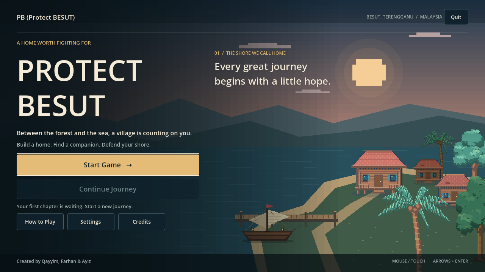
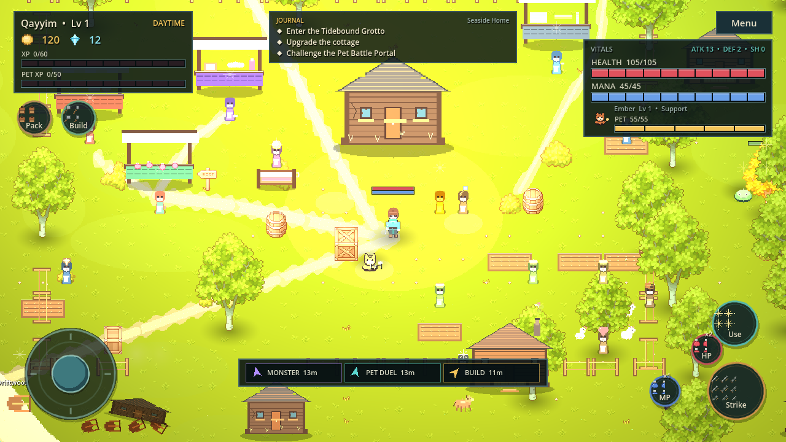
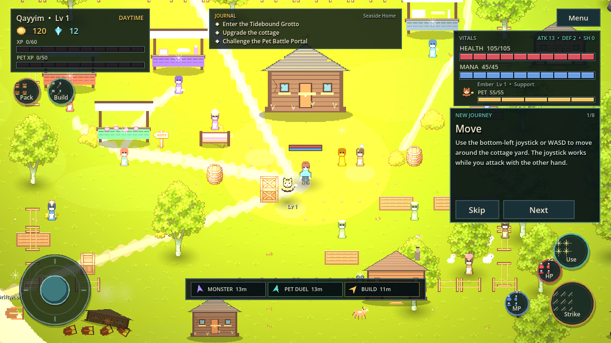
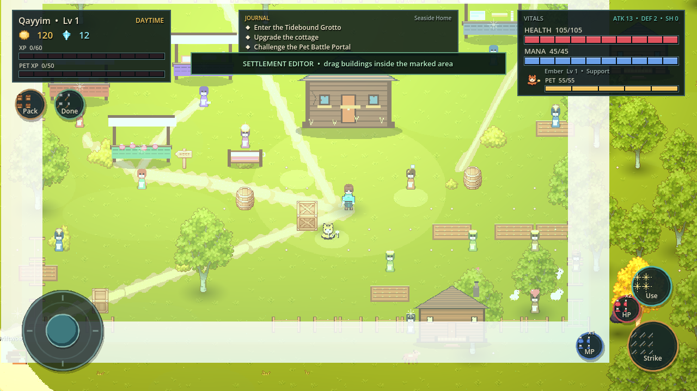
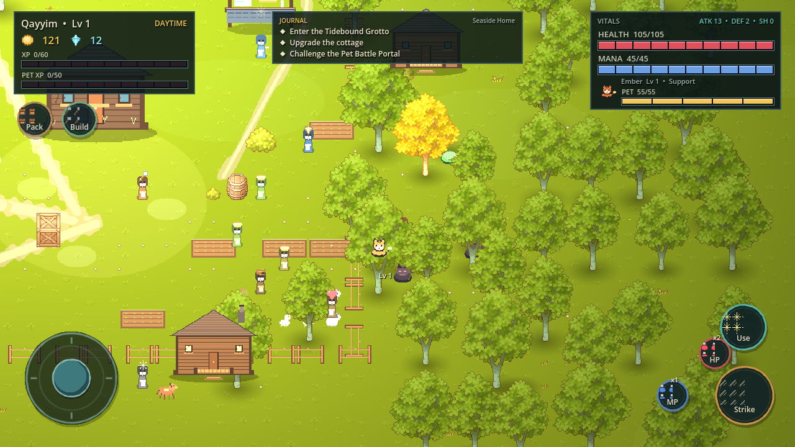
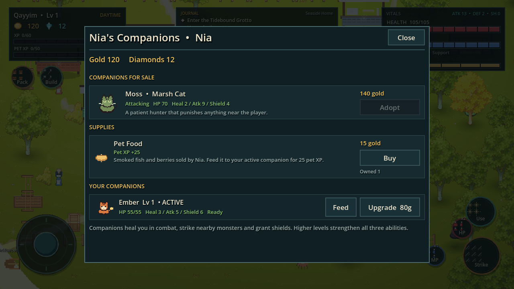
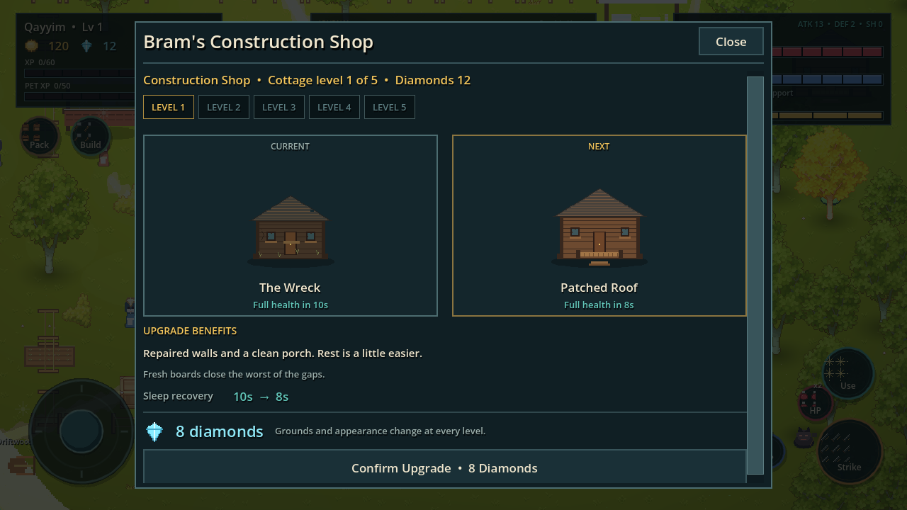
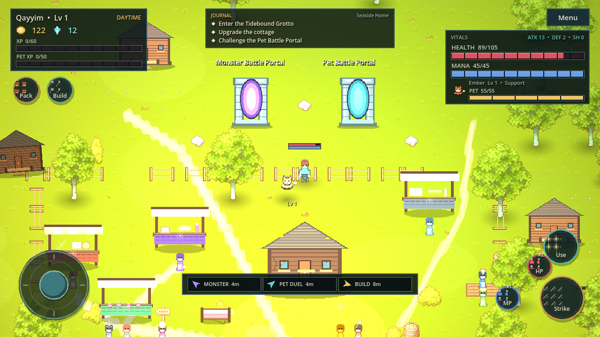
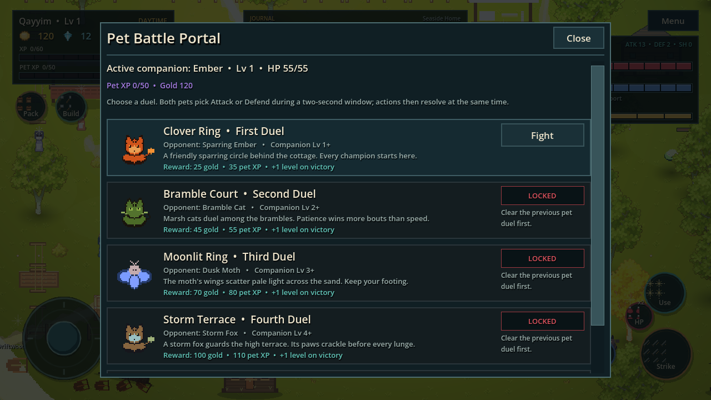
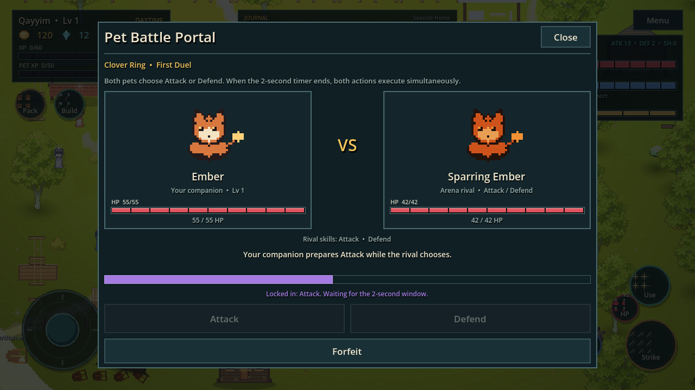

# Save The World — Tidesworn

A playable 2D pixel-art survival action-RPG vertical slice for **Godot 4.7.2**.

**Created by Qayyim, Farhan and Ayiz.**

Three heroes share one seaside story: keep the cottage, feed and level a
companion, clean the coast, shape the settlement, protect the forest, duel rival
pets and defend the village while raiding ten monster portal levels for gold,
diamonds and boss trophies.




## Monsoon Afterglow

The shipped village now has an original jade-and-mint tropical forest, seaglass
water, timber kampung-inspired homes, woven market stalls and clock-driven
golden-hour/lantern lighting. Low effects and Reduce Motion retain the complete
static artwork. [Art direction](docs/ART_DIRECTION.md),
[before/after evidence and verification](docs/MONSOON_AFTERGLOW_REPORT.md), and
[editable source artwork](assets/authored/monsoon/) document the overhaul.

## Run

1. Open `project.godot` in **Godot 4.7.2**.
2. Press **F5**. The main scene is `res://scenes/game.tscn`.
3. Choose Qayyim, Farhan or Ayiz from **Choose Your Road**.

The original converted Cainos demo remains at `res://scenes/main.tscn`; its
notes are in [`docs/LEGACY_CONVERSION.md`](docs/LEGACY_CONVERSION.md).

## Controls

| Action | Keyboard | Touch |
| --- | --- | --- |
| Move | WASD / Arrow keys | Bottom-left joystick |
| Attack | F | Bottom-right **Strike** |
| Interact / talk / enter / sleep / gather | E | Bottom-right **Use** |
| Backpack | I | **Pack** at top-left |
| Settlement editor | B | **Build** at top-left |
| Health potion | Q | **HP** |
| Mana potion | R | **MP** |
| Close modal | Esc | **Close** |

The backpack and Build buttons are deliberately away from the movement joystick
and combat buttons. There is no minimap and no collect button: loot is collected
automatically by touch. Floating NPC name labels and timed pop-up notifications
have been removed; persistent HUD panels and the journal carry that information.

## New Journey tutorial

Every new game starts an eight-step, non-blocking tutorial covering:
movement, combat, automatic item collection, shops, house upgrades, companions,
portals and village defence. **Next** advances; **Skip** dismisses it.



## Characters and combat

- **Qayyim** — sword; quick forward arc.
- **Farhan** — blacksmith's hammer; slower wide hits, higher damage and camera
  shake.
- **Ayiz** — bow; fires arrows at the nearest enemy in front of him.

Each starts with their own weapon. The equipment shop filters to the active
hero's weapon discipline while sharing armour and shields.

## Settlement systems

### Day and night
A journey starts with a peaceful 180-second day, followed by a 180-second night. The HUD counts down each phase. Fire monsters and sea urchins spawn only at night. Survivors keep fighting after sunrise, including after returning home or loading a save.

### Lively residential village
The fenced settlement contains three shops, Bram's cottage service, six garden
beds, dense flower borders, twelve residents, an animal corner, two horses and
four neighbouring resident cottages beyond the fence. Routines include fishing,
gardening, carpentry, wood hauling, animal keeping, farming, trading, stable work
and two village defenders. Four residents can join the defence.

### Custom settlement editing
Press **B** or the top-left **Build** button to open the settlement editor.
A marked building area appears. Drag the house, shop groups, fence runs, garden
beds and decorations with mouse or touch; positions are grid-snapped, clamped to
the area and saved. Press **Done** to resume play.



### Village defence and protected forest
While the player is in a portal, raiders may attack from **both the sea and the
forest**. The persistent emergency HUD marks the danger. The player is never
teleported and portal combat is never forcibly interrupted. Returning through
the Shore Gate spawns sea urchins, residents seek intact houses for shelter,
and buildings and resident cottages take
visible damage. The **73 forest trees have persistent HP**: forest monsters
ignite mature trees with visible flames and ongoing fire damage. Damaged trees
show an HP bar and disappear at zero health. Two blue-clothed water keepers
start with the village; up to five can be hired at the Water Keeper Shop
(80/140/200 Gold for the additional helpers). They heal 5 HP every 1.25 seconds
and replant fallen trees. Fire monsters only attack mature trees, never players.
Saplings grow for 30 seconds and cannot be attacked until mature. Losing all
mature trees with no planted saplings triggers a dry-orange terrain animation,
dark green sea and stranded dead sea life before the locked game-over screen.
Night replenishes the woodland to twenty-four fire monsters and the beach to six sea urchins. Raids can raise the fire population to thirty. Existing survivors remain active throughout the day.

Beached sea rubbish becomes sea urchins, which attack trees, fences, houses and
exposed residents. Houses and fence runs have persistent individual HP. During
danger, residents walk into an intact house and become protected; loss of all
shelters leaves them vulnerable to permanent death for that journey. Approach any damaged house or fence and press E / Use (Betulkan) to restore it immediately, for free. Damage, recruitment and resident deaths survive saves.

Every merchant stands inside a named shop. Click or touch the stall to open it directly; the keyboard interaction also remains available. New
players receive one of ten action-based missions at a time. Dotted arrows on
the ground follow paths around obstacles; the old bottom arrow notification bar
is removed. A tutorial spotlight dims the rest of the screen and points at the exact action to take. Mission progress resumes after Continue; tips can be reopened in Menu.

Forest monsters attack trees without waiting for the player. As soon as the
player enters a monster's line of sight, it immediately targets the player,
charges and attacks. Every defeated raider grants gold; clearing all raiders
restores the safe state.



### Sea cleaning
The Coastal Guard automatically nets drifting rubbish in the shallows. Every
catch awards exactly **+1 Gold** and increases the persistent sea-cleaning
counter. Dangerous rubbish that slips past the net transforms into a monster on
the sand, which the player can defeat for a separate gold reward. Talk to the
guard to open a persistent sea-cleaning report instead of a timed notification.

## Economy and shops

- Gold and diamonds with atomic, non-negative transactions.
- Potion shop, equipment shop, pet shop, inventory, equipment and selling.
- Purchase debounce, insufficient-funds rejection, data-driven prices.
- House upgrades accept **diamonds only** at Bram's dedicated **Construction
  Shop**, with a visible five-step Level 1-5 progression.
- Five cottage levels and sleep recovery at **10 / 8 / 6 / 4 / 2 seconds**.
- Coastal Guard rubbish catches award exactly **+1 Gold** without a pop-up.
- Beached rubbish transforms into a gold-rewarding monster instead.
- Driftwood gathering and selling provides a safe gold source.
- **Pet Food** costs 15 Gold at Nia's Pet Shop and grants 25 pet XP when fed.
- Persistent player and pet XP bars show the exact next-level requirement.
- Bram's Construction Shop presents the full Level 1-5 cottage path before each
  diamond upgrade.




## Companions and healing

- Starter **Ember** fox is granted automatically.
- Companions provide gradual healing, automatic attacks and periodic shields;
  levels strengthen all three abilities.
- Pets never die permanently, no Pet Revival Potion exists, and pets no longer
  provide portal lighting.
- At one health bar, a Health Potion is automatically used if available.
- Death returns the player to the cottage recovery ward. The player is held
  inside until fully healed; potions only accelerate recovery.

## Two battle portals

Two gates stand side by side on the north path:

- **Monster Battle Portal** — opens the ten-level campaign, each with at least
  ten regular monsters and one boss. Boss ability sets include punches,
  projectiles, charges, area slams and a combined projectile-charge pattern.
- **Pet Battle Portal** — opens a five-level 1v1 companion tournament. Both pets
  choose from **Attack and Defend**. Neither pet acts until the player selects an action, then both resolve together. Every subsequent round waits again. A victory grants Gold,
  pet XP, unlocks the next duel and always raises the companion's level.





Monster portals use the reusable dark dungeon scene, with loot, expedition
banking, defeat/reset and safe Shore Gate returns.

## Visual & feel overhaul

The `visual-overhaul-merge-2` branch repairs and extends a presentation layer on top of the same
rules (see `docs/VISUAL_OVERHAUL.md` for the design decisions):

- **Shops with people.** Every shop opens onto an illustrated storefront band
  with an animated shopkeeper (Mara stirs, Garrick hammers, Nia tends, Bram
  unrolls blueprints), contextual dialogue lines, browsing silhouettes, stock
  cards with before/after stat compare and in-panel buy feedback (coin arc,
  currency tick, keeper reaction). Scrolling survives background gold drips.
- **Movement & combat feel.** The hero eases in and out of movement with a
  4-frame walk cycle, footstep dust and hurt/death poses. Attacks are
  data-driven anticipation -> active -> recovery chains (sword 3-hit combo,
  hammer shockwave slam, bow draw-and-release); damage lands on the active
  frame and cooldowns preserve the original pacing. Hits flash, spark, count
  and micro-shake; enemies telegraph every attack with a ground decal before
  it lands.
- **Portals as the centrepiece.** Both gates animate (8-frame swirls, motes,
  rune glow, approach wake) with ten distinct PortalDB-driven themes, sealed
  frames while locked, golden auras once cleared, and a pull-in transition on
  entry. Dungeon floors are coherent stone with real wall faces, themed
  dressing, flickering torches and a boss-arena emblem.
- **A clear seaside village.** Trees, cottages and ruins own their correctly
  placed visuals and collision bodies. Grass uses working MultiMesh fields;
  masked water follows the painted shore, including its rounded eastern end.
  A turtle rests on sand and a wooden BESUT sign marks the village path.
  Ambient star placeholders, water sparkles and broad light washes are removed.
- **Residents go shopping.** Customers reserve a counter, walk around obstacles,
  browse, exchange a coin for goods, leave and resume their routes. These ambient
  transactions never touch the player's economy.
- **Continuous movement.** Physics bodies move through floating-point positions;
  pets catch up smoothly and can route around obstacles. Physics interpolation
  and an unsnapped camera retain nearest-filtered art without grid movement.
- **Independent interface and world scale.** Menu → Settings has separate GUI
  and camera zoom sliders. Zoom spans 28–64 (38 default), with smooth changes
  and device-level persistence. The anchored HUD scales without moving controls
  off-screen; touch targets retain at least 44 physical pixels. The top-right
  VITALS panel is removed; the player's world HP/MP indicator and XP bars remain.
- **Comfort settings.** Settings gains Effects quality (low/med/high) and
  Reduce motion. Touch buttons show keycap hints on keyboard layouts, a
  cooldown sweep on Strike, count badges on potions and a context-sensitive
  Use icon.

## Project structure

```text
scenes/
  game.tscn                 main flow scene
  main.tscn                 preserved converted demo
scripts/
  autoload/game_state.gd    state, economy, saves, emergencies, recovery
  autoload/sfx.gd           synthesized impact/aggro/skill/victory SFX
  core/                     procedural art, theme, camera
  data/                     characters, items, pets, portals, pet duels, houses
  player/                   player controller, sprite, arrows
  pets/                     follower and support abilities
  combat/                   monsters, bosses, projectiles
  world/                    lobby, dungeon, residents, rubbish, editor, defence
  ui/                       HUD, joystick, touch buttons, tutorial, modals
tools/
  tide_test.tscn            end-to-end acceptance test (dynamic check count)
  tide_capture.tscn         screenshot harness
docs/
  ACCEPTANCE_TESTS.md
  COMPLETION_REPORT.md
  QA_REPORT.md
  ARCHITECTURE.md
  ANDROID_BUILD.md
  LEGACY_CONVERSION.md
```

## Verify

```sh
# Linux: isolated user://, timeout, failure/error-log checks.
./tools/test_isolated.sh

# Graphical review: always isolate user data; captures never go into res://shots.
review_dir=$(mktemp -d /tmp/tidesworn-review-XXXXXXXX)
XDG_DATA_HOME="$review_dir/userdata" TIDESWORN_TEST_ROOT="$review_dir" godot --path . res://tools/visual_review.tscn -- --shots "$review_dir/shots"
```

The raw acceptance scene deletes its save. Never run it against real user data.
The suite must report PASS, exit 0 and have no SCRIPT ERROR / ERROR output; the
count is data-driven. The Monsoon Afterglow delivery passes 562 acceptance
checks, 63 native graphical checks, plus 27 editor checks and a separate runtime
restart. The protected incoming main baseline passed 524 acceptance checks.
The earlier deep audit passed 408 acceptance checks and 63 native graphical
checks. See [the audit report](docs/DEEP_AUDIT_REPORT.md) for
actual results, root causes, files and visual evidence, and
[acceptance guidance](docs/ACCEPTANCE_TESTS.md) for the contracts.

## Android

Configured for 1280×720 landscape, canvas-items stretch, expand aspect, nearest
textures, physics interpolation and GL Compatibility. Touch controls are implemented.
Export/signing and physical-device performance testing remain machine-specific;
see [`docs/ANDROID_BUILD.md`](docs/ANDROID_BUILD.md).

## Known gaps

- Music and ambient audio are not implemented; gameplay cues use generated SFX.
- Android signing and device profiling still need to be run.
- Damaged houses and fences can be repaired for free through their nearby Betulkan interaction.
- Boss abilities are implemented as one primary pattern per boss rather than
  full multi-phase move sets.
- Pet duels are resolved in an animated arena panel rather than a separate
  walkable world scene.
- Additional resident dialogue and ambient animal species can follow.
# godottgame

## Creative Studio

Open the **Tidesworn** main workspace in Godot 4.7.2 for Asset Library, Map Studio,
Pixel & Animation and World Palette. The coastal revamp retains the real runtime
and player save format while adding authored asset/map resources.

See [delivery](docs/CREATIVE_REVAMP_COMPLETION.md),
[asset workflow](docs/ASSET_WORKFLOW.md), [map guide](docs/MAP_EDITOR_GUIDE.md),
[pixel guide](docs/PIXEL_EDITOR_GUIDE.md) and [QA evidence](docs/CREATIVE_REVAMP_QA.md).
Run `./tools/test_isolated.sh` for gameplay and `./tools/test_creative_editor.sh`
for the isolated editor/import/save/restart workflow.

House upgrade levels are clickable previews: inspect any Level 1-5 design before deciding to buy the next upgrade. Pet duels wait for an explicit Attack or Defend each round. Five supplied battle backgrounds have per-duel paths configured, but the attachment downloads were blocked here; importing those local images remains pending.

### Coordinated village world

The village now uses a shared authored layout for its districts, functional
anchors, connected roads, building approaches and contextual workspaces. Map
Studio supports spatial overlays and undoable layout edits; player settlement
positions and all original forest associations retain precedence/identity.
See [world design and measured evidence](docs/WORLD_OVERHAUL_REPORT.md) and the
[layout/authoring guide](docs/WORLD_LAYOUT.md). Reproduce the actual-renderer tour
with `./tools/review_world.sh /absolute/output`; gameplay and authoring checks
remain `./tools/test_isolated.sh` and `./tools/test_creative_editor.sh`.
