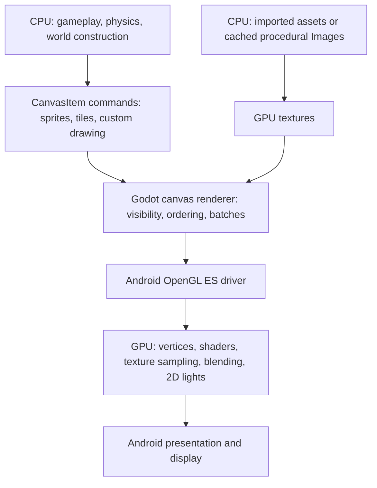

# Android rendering research and optimization plan

Date: 2026-10-30. Inspected source: `7b0af77`, branch `main`.
Target chosen by the user: **broad Android support, aiming for sustained 60 FPS**.
Status: investigation and proposed implementation sequence; no renderer or gameplay changes made.

## Recommendation

Keep **GL Compatibility as the baseline**. The game already renders with the GPU.
Optimize the work sent to it, the CPU work preparing frames, and Android frame
pacing. Evaluate Mobile/Vulkan in a controlled comparison after establishing a
device baseline. Adopt it only if measurements justify the compatibility cost.

Godot explicitly recommends Compatibility for 2D and older mobile hardware.
Mobile uses the RenderingDevice backend and Vulkan on Android; its name does not
make it automatically faster for this game. Compute shaders are unavailable in
Compatibility, but ordinary canvas vertex/fragment shaders already work there.
[Godot renderer guidance](https://docs.godotengine.org/en/stable/tutorials/rendering/renderers.html)

## How this game reaches the screen

`scenes/game.tscn` starts `Game`; its runtime worlds construct the visible nodes.
Godot handles rendering those nodes. GDScript does not replace the GPU rasterizer.
There are two distinct costs in procedural art: building an `Image` on the CPU,
then uploading its texture. Repeated frames normally reuse that texture.

Custom `_draw()` also submits GPU drawing commands. Godot retains these commands
until `queue_redraw()` requests rebuilding them. A custom drawing function is
therefore not automatically slow; unnecessary rebuilds and excessive primitives
are the things to measure.
[Godot custom drawing](https://docs.godotengine.org/en/stable/tutorials/2d/custom_drawing_in_2d.html)

## Verified source findings

Paths below are relative to the repository root. Costs are hypotheses unless
explicitly described as an inventory calculation; none are phone measurements.

| Area | Current behavior and source | Implication |
| --- | --- | --- |
| Backend | `project.godot:127`: desktop and mobile overrides both select `gl_compatibility`. | GPU rendering is already configured. Record the actual runtime backend as well as the requested setting. |
| Resolution | `project.godot:27`: 1280 x 720 reference size, `canvas_items`, `expand`. | The reference size does **not** cap actual rendering resolution. A higher resolution phone increases pixel work. |
| Terrain | `scripts/creative/world_terrain.gd::_make_terrain_texture()` prefers an imported bake when geometry/palette hashes match. `data/maps/village_layout.tres` references that bake. | Preserve this path; measure whether current inputs select it at runtime. Regeneration is primarily a startup/transition concern. |
| Twilight | `scripts/world/twilight_landscape.gd::terrain()` generates and caches a 672 x 624 image, from `RealmDB.SIZE` of 56 x 52. | The first realm has its own terrain path; optimizing legacy Dungeon floor shaders alone will not optimize this background. |
| Grass | `scripts/world/lobby.gd:1299`: 520 placement attempts, filtered by layout; up to six meshes grouped by texture variant. `scripts/core/shaders.gd` bends foliage on the GPU. | Existing GPU instancing and shader animation are valuable. Actual instance counts are lower than placement attempts and need logging. |
| Lights | `scripts/world/lobby.gd:800`: daylight updates every 0.12 seconds; nearby village lights capped at four on High, two on Medium, disabled on Low. | Already budgeted. Measure overlap and affected screen area before further changes. Other worlds and portal-owned lights need separate accounting. |
| Ocean | `scripts/world/ocean_scenery.gd:36` requests redraw every animated frame. `_draw()` includes a static seabed polygon and 75 static lines, plus 35 moving kelp polylines and bubbles in the pixel path. | Separate static commands from animated content. Candidate for cached geometry plus shader motion. |
| Ocean background | `scripts/world/ocean_journey.gd::_draw()` draws broad color bands, rays and animated bubble arcs in the pixel path. | Profile command preparation and transparency separately from gameplay collision and rubbish processing. |
| Title | `scripts/ui/title_backdrop.gd` redraws the entire diorama at 30 Hz when animated. | Static/dynamic separation could reduce idle CPU work; title art already has a quality/reduced-motion gate. |
| Spells | `assets/shaders/realm_spell.gdshader` evaluates noise, trigonometry, powers and exponentials. Effects/projectiles/hazards own clock and state uniforms. | GPU fragment cost and material changes are candidates, especially with overlapping large effects. Setting motion false alone retains much of the shader's calculation. |
| Imported art | `scripts/core/realistic_art.gd:119` caches CPU sheet Images, crops/pads regions, creates individual ImageTextures and overrides logical size. `RealmPresentation.actor_texture()` already uses AtlasTexture for some actors. | Some illustrated art loses atlas sharing and retains CPU copies. Physical pixel size can exceed reported logical size; inspect actual resources. Pixel style bypasses this RealisticArt path. |
| Texture settings | Defaults and sampled illustrated imports use lossless compression, no mipmaps. `import_etc2_astc=true` is enabled. | Enabling the import format does not itself compress lossless assets or generated ImageTextures. Use per-asset decisions. |
| Effects | `scripts/core/vfx_pool.gd` preallocates sprites/labels. Portal motes use four CPU particles; other emitters exist in village/dungeon code. | Preserve pooling. Tiny particle systems are not an automatic priority for GPU migration. |
| UI | `scripts/ui/village_minimap.gd:42` refreshes at 0.15 seconds and skips hidden updates. | Already throttled; cache stable map content if profiling identifies it. Do not describe it as rebuilding every frame. |
| CPU simulation | `scripts/combat/enemy.gd::_separate()` refreshes an enemy group scan every 0.12 seconds per enemy; targeting and interactions have other group queries. | Could become CPU-bound as counts grow. GPU changes will not remove these costs. Existing scan throttles must be credited. |
| Diagnostics | `scripts/core/runtime_diagnostics.gd` logs memory/node counts every 30 seconds and records the configured renderer. | Add actual backend, draw and frame distributions; the present logs cannot diagnose GPU time or frame pacing. |
| Exports | `export_presets.cfg`: Android only, ARMv7 + ARM64, package `com.tidesworn.protectbesut`, 1.3.1/code 10, all-resources export with exclusions. | Preserve identity/signing continuity. Check package contents for unused art families rather than deleting assets blindly. |

Asset inventory from PNG headers: 96 PNGs under `assets/`; an RGBA8 expansion of
every file would total about **312 MiB**, without mipmaps. Illustrated files account
for about 126 MiB and the older realistic directory for 108 MiB. This is an inventory
estimate, **not resident RAM or GPU memory**: files may be unused, imported formats
may differ, and runtime crops/caches can add other allocations. The 2048 x 1280
village terrain alone would be 10 MiB as RGBA8 without mipmaps.

Historical performance JSON exists, including a 48-enemy stress fixture on an AMD
Vega 3. It is dated desktop evidence for an older source state. It does not establish
current Android bottlenecks, supported enemy counts, or achievable phone FPS.

## Performance contract and measurement

At 60 FPS, a display interval is **16.67 ms**. CPU and GPU stages overlap; do not
add Godot process, physics and GPU timings as if they were independent totals.
Distinguish measured CPU/GPU work from presented frame intervals and intentional
frame limiting. Treat 60 FPS as a goal to validate on a declared device floor, not
a promise for every Android phone.

Proposed acceptance targets:

- On the agreed minimum supported phone, normal gameplay should maintain 60 FPS
  after warm-up and during a 20-30 minute session. Aim for p95 measured CPU work
  and GPU work each below 14 ms to retain headroom; validate presented cadence
  near 16.67 ms, count missed display deadlines and record p99/hitches separately.
- Measure startup and world transitions separately from steady gameplay. Record
  first-use shader/texture hitches rather than excluding them from the report.
- No continuing memory growth after repeated village/realm/ocean/shop/duel cycles
  beyond explainable cache warm-up. Set numerical memory limits after the device
  floor and actual resident usage are known.
- Preserve visual readability, responsiveness, combat timing, persistent progress
  and simulation behavior. Optional 30 FPS battery mode is useful, but is not
  evidence that the 60 FPS goal has been met.

Start with at least three physical devices: a budget device at the proposed floor,
a mid-range device and a recent device. Include Adreno and Mali families, Android
versions actually supported by the exported build, different RAM capacities, and
60/90/120 Hz displays. ARMv7 needs a real launch/gameplay check if retained in the
support contract. Record device model, OS, GPU/driver, resolution, refresh rate,
quality, art style, build ID and thermal conditions with every result.

Use release exports for final timing, plus a separate development build for script
profiling. Collect Godot counters and CPU profiles, Android system/FrameTimeline
traces where supported, and GPU traces on supported devices. Android GPU Inspector
uses ANGLE for OpenGL ES frame tracing, so confirm conclusions on the native GLES
path too; translation can alter behavior.
[AGI profiling details](https://developer.android.com/agi/troubleshooting)

Benchmark one change at a time with identical scenario, camera and state. Repeat
baseline/candidate runs at comparable temperatures; capture screenshots in separate
runs so readback and file I/O do not contaminate timing.

| Scenario | What to measure |
| --- | --- |
| Cold launch/title/Continue | Loading, procedural generation, initial shader work, idle CPU and power. |
| Village day, forest and coast | Camera movement, grass, terrain, residents, controls. |
| Village night and a normal raid | Lighting overlap, burning trees, enemies, workers, combat effects; preserve offscreen simulation. |
| Twilight exploration and citadel boss | Realm-specific art, guard encounters, telegraphs, overlapping spells, restored revisit. |
| Habitat pet challenge | Existing PetBattlePanel, suspended realm behavior and return. |
| Ship/ocean routes/Kraken | Moving scenery, water, hazards, controls, fullness and combat. |
| Menus, shops and large map | Rebuilds on signals, text, transparency and simulation continuing behind menus. |
| Repeated world transitions and background/resume | Resource retention, input cleanup, recovery, Android lifecycle. |

## Implementation sequence

### 1. Establish reproducible Android evidence

Deliver a deterministic benchmark route and optional performance capture mode.
Extend `RuntimeDiagnostics` to report actual rendering method/driver/GPU, actual
viewport and window sizes, FPS cap, quality/art style, rolling frame distributions,
CPU process/physics, draw calls, primitives, texture memory where available, node
counts and texture generation/cache events. Use buffered summaries, not per-frame
disk writes. Instrumentation overhead must be compared with capture disabled.

Reuse fixture infrastructure, but create a dedicated isolated Android test identity
or equivalent sandbox. Existing desktop tests delete fixture saves; an ordinary
installed production package is not a safe acceptance-test sandbox. Keep test
tools excluded from the production preset and include a harness only in the
dedicated benchmark export. Keep benchmark identity separate from release identity.

**Exit:** current source baseline on real devices, with evidence classifying each
slow scenario as CPU preparation, simulation, GPU pixel/shader work, memory/loading,
presentation, or a combination. Do not label FPS alone as GPU time.

### 2. Set an Android frame and quality policy

Add a device preference for 60 FPS, with an optional explicit 30 FPS battery mode.
Apply it through `GameSettings`; defaults and sanitization stay separate from
journey data. Test input latency and cadence on 60/90/120 Hz screens.

Godot already exposes Android Swappy settings, with frame pacing enabled by default.
Its default automatic mode can settle at 30 FPS when a workload fluctuates between
40 and 60. With no FPS cap it can target the display refresh rate. Verify the
exported behavior; compare modes rather than installing another frame-pacing
library by default.
[Godot frame pacing settings](https://docs.godotengine.org/en/stable/classes/class_projectsettings.html#class-projectsettings-property-display-window-frame-pacing-android-enable-frame-pacing)

Start fresh Android settings at Medium as an experiment, retaining existing user
choices. Quality tiers should reduce decorative motion, shader cost, particle
counts and light coverage while keeping essential flame, health and attack feedback.

**Exit:** measured pacing policy and live settings that preserve touch behavior;
no uncontrolled 90/120 FPS rendering when the user chose 60.

### 3. Test a real cap on 2D rendering resolution

This is a high-priority experiment if GPU pixel work is limiting. Compare current
native rendering with a viewport capped around 1280 x 720, and a lower tier around
960 x 540, adapting width for aspect ratio. These are trial values, not final art
decisions. 1280 x 720 is 44% of the pixels of 1920 x 1080; that calculation does
not predict an equal frame-time saving.

First prototype root `viewport` stretch in an isolated configuration. Keep camera
framing and world units equivalent. It also scales the UI, so inspect text and
control readability. If native-resolution UI is necessary, evaluate a world
SubViewport with root UI as a separate, larger architecture change: measure the
extra composite pass and explicitly map screen input to world coordinates.
Godot's 3D render scale does not provide this 2D solution.
[Godot resolution behavior](https://docs.godotengine.org/en/stable/tutorials/rendering/multiple_resolutions.html)

Test wide phones, safe areas, camera zoom, direct taps, simultaneous touches,
minimap/world map, GUI scaling, saved control-layout positions and ocean controls.
Do not compensate for resolution changes by altering movement or collision units.

**Exit:** lower GPU time/thermal load at acceptable appearance and unchanged input
mapping; otherwise discard or revise this experiment.

### 4. Reduce repeated CPU drawing work and unnecessary submissions

Split OceanScenery and TitleBackdrop into cached static content and independently
animated visuals. Retain static draw commands or bake presentation layers during
authoring. Try shared vertex-shader kelp and bounded sprite/particle bubbles when
profiling supports it. Do not move every background operation to an expensive
full-screen fragment shader.

Skip or reduce **presentation** work outside the view, including cosmetic clocks,
glows and scenery motion. Preserve world simulation: offscreen fire, resident work,
enemy damage, tree growth and clock behavior must remain correct. Existing normal
menus continue simulation, while accepted habitat challenges suspend the realm.

Benchmark spatially chunked grass only if coarse visibility is costly. The existing
six texture batches can be efficient at this scale; chunking increases batch count.
MultiMesh instances share a visibility unit, so chunk size is a culling/draw-call
tradeoff. Do not combine interactive or Y-sorted actors in a way that breaks depth.
[MultiMesh behavior](https://docs.godotengine.org/en/stable/classes/class_multimesh.html)

**Exit:** lower CPU/draw preparation time in the affected scenarios, with comparable
visuals and no change to simulation results or deterministic forest associations.

### 5. Lower shader, transparency and texture costs where measured

Create simpler Low/Medium spell variants, or small precomputed flipbooks, for
decorative noise. Retain exact telegraph extents, activation times and visibility.
Reduce overlapping glow area and transparent padding; keep material/blend changes
low while preserving drawing order. Reuse compatible materials, but effects with
different activation/fade/clock values cannot blindly share one mutable material.
Batching and overdraw are separate costs.
[Godot GPU optimization](https://docs.godotengine.org/en/stable/tutorials/performance/gpu_optimization.html)

Share visual time where safe and write unchanged quality uniforms only on settings
changes. Any replacement for per-effect clocks must respect suspended worlds,
story overlays and ocean Settings; shader `TIME` alone does not inherit those
gameplay suspension rules. Keep damage, collisions, ownership checks and effect
lifetimes authoritative on the CPU.

For modern illustrated art, prefer imported/padded atlases or an authoring bake
over retaining CPU sheets plus duplicated region textures. Preserve logical sizes,
animation feet, tree upper/lower splits, offsets and fallback/override precedence.
Some actors already use AtlasTexture; extend selectively rather than rewriting
that working path. Profile cache growth and eviction, including the full-cache
clears in PixelArt and RealisticArt, before selecting an eviction policy.

Keep small pixel sprites lossless with nearest filtering. Trial downscaling or ETC2
compression only for suitable large art, with screenshot comparison. ASTC should
not be presumed usable by the Compatibility path simply because its import toggle
is enabled. Mipmaps are selective: useful for heavily minified illustrated art,
but increase memory and can change pixel-art appearance.
[Godot texture import tradeoffs](https://docs.godotengine.org/en/stable/tutorials/assets_pipeline/importing_images.html)

Large particle systems may merit GPUParticles2D after device testing; four portal
motes probably do not justify a migration by themselves. CPU particles can perform
better on some low-end or GPU-limited workloads.
[Godot particles guidance](https://docs.godotengine.org/en/stable/tutorials/2d/particle_systems_2d.html)

**Exit:** measured GPU/memory or startup improvement, preserved pixel art and clear
combat feedback, stable memory after repeated transitions.

### 6. Address simulation bottlenecks and sustained heat

If profiles show CPU limits, introduce world-owned spatial queries/shared group
snapshots for enemy separation and targeting. Stagger expensive noncritical
searches. Preserve active-world/dead/sheltered filters and target invalidation.
Do not reduce physics tick rate or combat accuracy as an incidental rendering fix.

Add optional adaptive visual quality only after manual tiers are effective. Use
rolling load measurements with hysteresis, change quality slowly, and avoid
oscillation or persistent overwriting of the user's preferences. Android thermal
status/headroom can inform later adaptation through a verified Godot Android plugin
or native integration; it is not an assumed built-in GDScript feature. Retain a
fallback for devices without useful thermal readings. Recheck Gradle/native build
requirements if a plugin is introduced.

Android recommends baselines and extended sessions for thermal optimization.
Test 20-30 minutes under repeatable conditions before accepting adaptive behavior.
[Android sustained-performance guidance](https://developer.android.com/games/optimize/adpf/best-practices-adpf)

**Exit:** a device report showing cold and warmed behavior, power/thermal evidence
where available, and no offscreen progression or combat regressions.

### 7. Compare Mobile/Vulkan and certify the result

Create separate experimental exports with identical assets, resolution, quality,
frame cap and gameplay. Configure the Android renderer override deliberately and
log the backend actually selected, including fallback. Compare steady CPU/GPU
time, frame pacing, first-use hitches, memory, startup, heat and visual differences.
Use the same phones and comparable thermal starting states.

Keep Compatibility as the broad-support release baseline unless Mobile improves
the target-device results without unacceptable driver/visual regressions. Automatic
fallback handles initialization support; it does not prove good performance or
correct visuals on a device whose Vulkan driver initializes successfully.

Run isolated import and the canonical Windows gameplay gate for implementation,
then affected Twilight/portal/story/ocean/controls checks. Inspect actual rendered
captures at 1280 x 720 and 832 x 480 plus physical phone aspect ratios. Any
authoring bake/import changes need disposable source-copy testing as AGENTS.md
requires. Run `git diff --check` and inspect the scoped diff.

For delivery, build the requested Android artifact with the matching engine
templates, preserve production package/signing identity, and verify architecture,
signature and alignment. Desktop/headless PASS validates logic only; final
performance claims require real-phone release measurements.

## First implementation batch

Start with **instrumentation + isolated Android benchmark route**, followed by
**60 FPS pacing policy** and the **2D resolution experiment**. These establish
whether subsequent effort belongs in shaders, CPU drawing, simulation or memory.
Land each independently with before/after evidence; avoid a large unmeasurable
rewrite of the renderer.

## Evidence limits for this research pass

- Repository root and clean starting branch checked; source paths/symbols inspected.
- Installed Windows console reports `4.7.2.stable.official.ed1daf0bf`.
- Official Godot and Android documentation researched; some tutorial pages mark
  themselves as awaiting a 4.7 update, so exact backend behavior still needs testing.
- PNG header inventory calculated without importing/modifying art.
- No gameplay tests, APK build, GPU capture or physical-device benchmark performed.
  No speedup or 60 FPS result is claimed. The only repository change is this plan.
