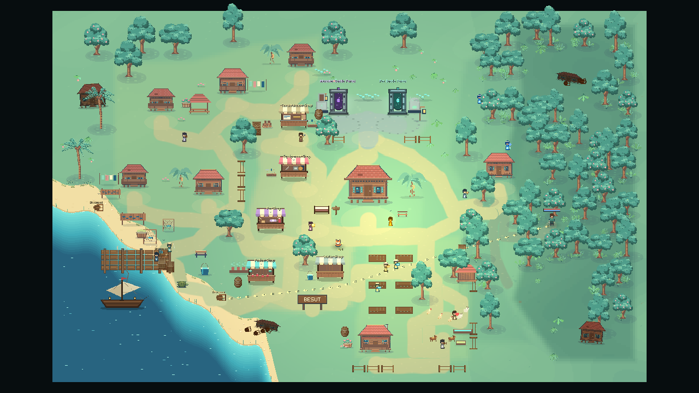

# Village districts and spacing — 24 October 2026

This is the second implementation pass on `codex/kampung-world-redesign`, after
`ed190ff`. It addresses the follow-up request to space things out, remove arbitrary
placement, and establish residential, commercial and other recognizable areas.
The first pass and its research remain in [KAMPUNG_REDESIGN.md](KAMPUNG_REDESIGN.md).

## What needed a deeper change

The first pass connected destinations but still left ordinary homes scattered
across the west, south and east. Crop beds mixed with cottage/service space;
the water counter sat apart from the market. Non-overlapping shop plots could
still be only 0.2 units apart. Repeated household decoration kits, random flower
clumps, four detached source-map planters and a large rectangular fence made the
geography look assembled rather than inhabited.

The new plan assigns everyday uses before dressing them. Five ordinary households
share the western/northwestern lane and wakaf court. The carpenter, equipment,
pet, potion and water merchants form one commercial crescent. The home cottage
retains its open central arrival. Six crop beds form two columns along one garden
aisle, with animal care, stable and a working homestead to the southeast. The
eastern residence becomes a forest watch lodge. Harbour work stays at the landing;
the sanctuary and fixed forest retain their geographic roles.

## Concrete geography

| Area | New canonical positions / structure |
|---|---|
| Residential lane | Five homes at (8.8,19.4), (11.7,11.2), (19.4,9.3), (26.8,6.4), (16.8,20.2); court at (16,14.1) |
| Market crescent | Carpenter (26,12.9), equipment (26,18.4), pet (23.5,24), potion (22.5,29.6), water (29.9,29.2) |
| Central homestead | Cottage (34,21.4), arrival (34,24.3); kept open and distinct from commerce |
| Agricultural district | Beds at x=35/37.9, y=26.6/29.5/32.2; animal yard (42.6,33.1), stable (42,35.4), farmhouse (34.8,37.2) |
| Forest edge | Watch lodge (48.1,18.4); workpoints follow woodland access |
| Waterfront | Nets, drying, baskets and mooring grouped around the landing; rope lies on the actual timber deck |

The world remains 64 × 40. There are 58 anchors, 41 routes, 10 zones, 45 scenery
records and 30 activity records. Two explicit farm/animal links extend the old
39-edge graph. Main routes use approximately 2–2.3-unit widths, service lanes 1.8,
and forest tracks 1.2. Route bends, approaches and district polygons follow the
relocated uses. The large village fence is replaced with shorter district edges
and meaningful openings, retaining its existing IDs.

## Spacing and placement rules

Active house/shop/residence/portal plots now require **1.8 units minimum between
their full footprint edges**, up from a measured minimum of 0.2 in `ed190ff`.
The closest default pair is now exactly 1.8; pairs involving ruins require 1.0.
`WorldLayout.crowded_buildings()` exposes violations in Map Studio as well as
the gate. This covers cramped placements whose rectangles do not overlap.

Maintained yards exclude wild vegetation around households and merchants.
Accessories use a low ground footprint, plus 0.1 units around road/entrance checks;
they must avoid the full road ribbon, destination approach and neighbouring
building footprint. Every default scenery record and movable decoration passes.
Map Studio uses the same visibility checks and outlines the selected maintained
yard. Prepared segments/rectangles keep accessory checks out of per-frame work.

Removed the global 34-attempt random flower loop, four detached source planters,
repeated whole-house kits, duplicate work props and an obstructing decorative
sanctuary arch. Five deliberate flower beds remain at selected plot edges.
Scenery records decrease from 65 to 45. The original sanctuary monuments remain.
Nets belong at the landing, tools beside the carpenter, and feed beside animals.
Crates, barrels and the sign retain their existing independent save IDs and gain
purposeful owner-local defaults clear of public circulation.

All twelve daily residents retain continuous collision-aware movement. Their
semantic workpoints follow the new household, merchant, farm and harbour anchors.
The path tests require actual arrival and bound every step by speed × delta.
Animals retain their existing ambient behavior; this pass does not add roaming AI.

## Paired actual-renderer review

Before is an archived checkout of `ed190ff`; after is this source. Both ran the
same current `tools/world_review.gd`, sequentially, using Godot 4.7.2 Compatibility
under Xvfb/llvmpipe. Each side contains **35 real PNG captures**, manifests, actual
movement samples, damage-asserted combat and raw performance data. Presentation
fixtures hold environment actors; a separate workload measures live residents.

Ordinary views use 1280 × 720, zoom 38. The overview uses diagnostic zoom 17,
deep forest zoom 64, and small-screen fixture 832 × 480. Day/night are held at
world time 45/205. Actual camera centres and settings are recorded in manifests.

| View | Before | After |
|---|---|---|
| Whole village | [image](evidence/district-spacing/before/overview-clean.png) | [image](evidence/district-spacing/after/overview-clean.png) |
| Shared residential lane | [image](evidence/district-spacing/before/residential-lane.png) | [image](evidence/district-spacing/after/residential-lane.png) |
| Lower market | [image](evidence/district-spacing/before/market-lower.png) | [image](evidence/district-spacing/after/market-lower.png) |
| Farm and animal yard | [image](evidence/district-spacing/before/farm-yard.png) | [image](evidence/district-spacing/after/farm-yard.png) |
| Night households | [image](evidence/district-spacing/before/night-residential.png) | [image](evidence/district-spacing/after/night-residential.png) |
| Night agriculture | [image](evidence/district-spacing/before/night-farm.png) | [image](evidence/district-spacing/after/night-farm.png) |

The review led to further doorway/fence adjustments, shorter household decoration
sets, clear merchant side yards, and moving harbour equipment off the wider paths.
Fixed trees remain visible within some village views; they are persistent gameplay
objects whose exact associations are deliberately preserved.

## Measured cost and navigation tradeoffs

These are software-renderer samples, in milliseconds (frame median / p95):

| Workload | Before | After |
|---|---|---|
| High | 23.60 / 26.59 | 22.74 / 25.65 |
| Medium | 23.67 / 27.31 | 22.36 / 25.77 |
| Low | 17.86 / 20.22 | 16.50 / 18.63 |
| Live residents | 24.42 / 28.84 | 23.20 / 26.83 |
| Cold construction, one sample | 206.46 | 355.70 |
| Warm construction | 30.32 | 32.69 |
| Eight destination plans | 14.33 | 12.73 |

Node count falls **1589 → 1403**, with roughly **35 fewer draw calls** at each
quality tier and about 145 KiB less High texture memory. Live-resident physics
monitor time rises 0.95 → 2.92 ms; frame medians improve in this sample despite
that increase. Cold construction rises about 149 ms in this pair; cold runs vary
substantially and the new footprint preparation adds construction work. These
measurements do not prove faster startup or native mobile performance.

Actual collision-aware paths from arrival, in world units:

| Destination | Before | After |
|---|---|---|
| Equipment | 12.76 | 8.81 |
| Carpenter | 14.01 | 13.26 |
| Pet shop | 8.73 | 9.77 |
| Potion | 9.48 | 12.41 |
| Jetty | 22.60 | 21.66 |
| Monster portal | 15.42 | 15.39 |
| Pet portal | 15.42 | 14.25 |
| Forest defence | 14.60 | 14.60 |

The more spacious market makes pet/potion trips longer. Equipment and carpenter
access improve; all eight measured destinations remain reachable. Complete raw
figures are committed under the paired evidence folders.

## Verification and compatibility

- Isolated import and explicit source bake/reimport: clean; full RGBA bake parity
  remains covered by the gameplay gate.
- `./tools/test_isolated.sh`: **893 checks, PASS**, exit 0.
- Native graphical deep audit: **63 checks, 0 failures**, exit 0.
- `./tools/test_creative_editor.sh`: **37 checks, 0 failures**, followed by a
  separate **creative restart PASS**, using a disposable source checkout.
- Both actual-renderer tours: **WORLD_REVIEW PASS**, 35 captures per side.
- Logs scanned for `[FAIL]`, `SCRIPT ERROR`, `ERROR:` and tool failure markers:
  clean. Xvfb input-method and unsupported V-Sync warnings are environmental.
- `git diff --check`: clean. No build exports or normal player-data writes.

New checks cover physical district membership, grouped homes and merchants,
minimum edge separation, every default accessory, an intentionally squeezed
non-overlapping building pair, clutter in the arrival court and saved crate
precedence. The old obstacle audit occupied the new farmhouse site: its whole
fixture was translated seven units west, preserving relative positions, wall
sizes, durations, speed limits and assertions.

Player settlement positions still take precedence over developer defaults.
Attached accessories that conflict after customization hide without changing
saved positions and can reappear when clear. Arbitrarily sealed player layouts
remain a reported placement problem. No save field or migration was added.
All 64 original forest IDs, positions, creation order and maximum HP pass the
unchanged fixture. Gameplay RNG, shoreline collision, portal IDs/progression,
combat rules, recovery and continuous movement retain their existing contracts.
Physical Android, native Windows and extended human playtesting remain unverified.

Evidence is in `docs/evidence/district-spacing/`. Editor screenshots are deliberate
authoring test maps, including validation warnings, rather than the shipped map.
