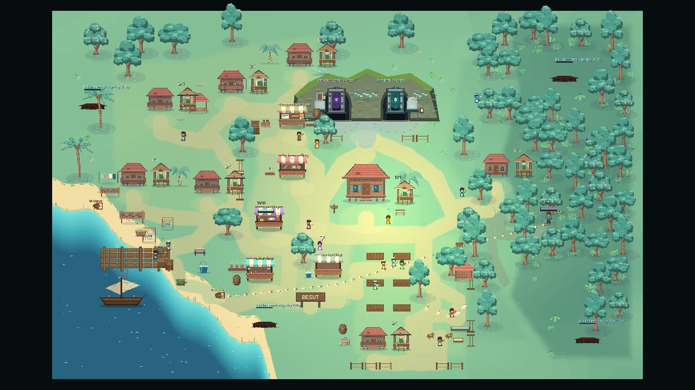
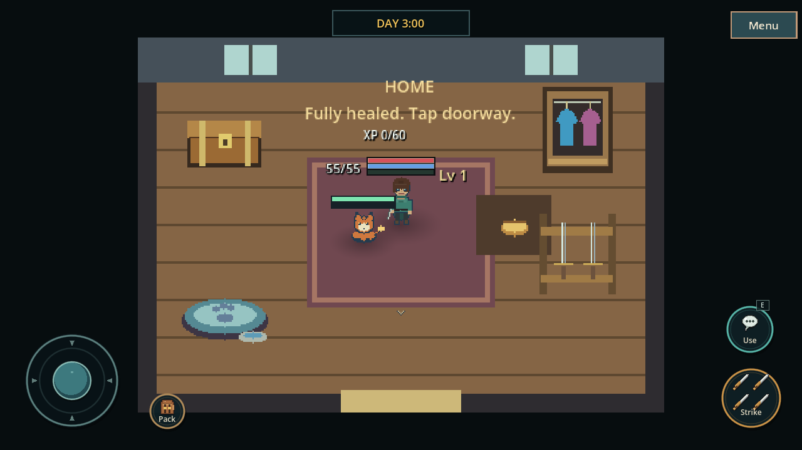
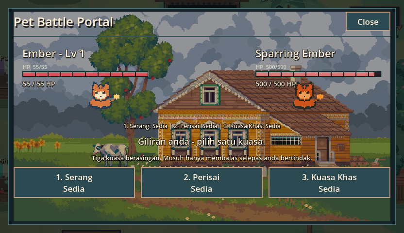

# GDT2 gameplay integration — 24 October 2026

Imported the uncommitted work from
`/home/roku/Documents/games/gdt2/godottgame` into this checkout, starting from
local main `94bfdd1`. Source HEAD was `0652c65` on `visual-overhaul-merge-2`.
The source checkout itself was not committed, switched, reset or rewritten.

## Branches and preservation

- `codex/gdt2-source-snapshot`, commit `9e7d201`, preserves 109 source files with
  substantive gameplay/documentation changes and new art/tools. Text is normalized
  to LF. The snapshot retains the source's original Git base.
- `codex/gdt2-gameplay-integration` combines that snapshot with the existing
  Creative Studio, Monsoon presentation, district-spacing pass and Map Studio.
  It is the dedicated integration branch promoted to local main after validation.
- 543 tracked files differed only by line endings; they were not imported as
  changes. The untracked `Godot/` directory contains runtime userdata/log output
  and was also excluded. New gameplay scripts, UID files, pet backgrounds and
  review tools were retained.
- An exact raw copy and manifest were preserved at
  `/tmp/tidesworn-gdt2-import-2w3ccn8t/` before integration. After validation,
  source HEAD and all 653 captured changed/untracked files still matched their
  original hashes. The committed evidence manifest records original source-byte
  hashes; these can differ from normalized text in the snapshot.

The earlier gameplay import `a1083ee` provided a useful content baseline for
conflict resolution. It avoids mistaking already-integrated gameplay for new
changes while preserving the current creative code around it. The final merge
retains both the current main history and the source snapshot parent.

## Integrated behavior

- PB title, minimal world HUD, overhead player/pet/boss information, mission NPC,
  separate day/night training, loading covers and modal entry fades.
- Furnished central-home entry/exit with companion transfer and tier-based
  recovery; return restores the village camera and controls.
- Builder, water, planter and fighter specialists, worker recruitment/deaths,
  daytime timed construction, persistent partial repairs, and a shared village
  tier controlling houses, fence art, archer huts and baseline worker counts.
- Three manual pet powers with independent cooldowns, player action before the
  enemy reply, and all five installed supplied arena backgrounds. The original
  GIF is retained alongside the PNG frame used by Godot.
- Illustrated Buku BESUT, named bosses, immediate dungeon pursuit and the incoming
  house/fence/forest support behaviors.

Current palette/registry overrides, cached art, personality animation, save
precedence, layout-owned routines and editor workflows remain integrated.
GameState retains state ownership and the existing user-data identity.

## Compatibility resolutions

The current authored village remains geographically authoritative. The imported
cave ridge follows the two resolved sanctuary portal anchors, rather than the
source checkout's older fixed far-north coordinates. The HUD regression now
checks the actual runtime portals/ridge against those anchors. Portal IDs,
unlocking and interactions remain intact. Historical gate exclusions used by
forest creation stay at their original coordinates; all 64 original forest
associations pass the existing fixture. No terrain or district resource was
replaced, and every measured arrival route retains its prior distance.

New specialists start relative to the authored keeper/workshop/garden/market
locations. Ordinary residents retain their authored occupational routes and
personality animation, while specialist roles own the incoming combat/repair
jobs. Recoverable former ruins retain their authored IDs/positions; adding their
structure behavior does not append coordinates to the frozen forest exclusions.

Home entry replaces the outdoor bed, and the existing house marker continues
to follow the saved cottage position. The newer source loading flow is awaited
by the existing editor restart, focused spatial probe and world review tools;
they inspect a fully constructed world rather than a loading cover. Static
resource-cache cleanup remains present on Game exit.

The graphical review found the new home's recovery sentence overlapped its
wardrobe. It now uses a centered two-line status above the furnishings; the
99-check native upgrade/home/guide run was repeated successfully afterward.

## Verification

Godot `4.7.2.stable.arch_linux.ed1daf0bf`; all runs use verified temporary user
data. Source import uses isolated XDG data. Editor source writes happen only in
the disposable checkout made by the existing runner.

| Check | Result |
|---|---|
| Isolated import | Clean, exit 0 |
| `./tools/test_isolated.sh` | **898 checks, PASS**, exit 0 |
| `tools/pb_test.tscn`, isolated headless | **86 checks, PASS**, exit 0 |
| `./tools/test_creative_editor.sh` | **84 checks, 0 failures**, exit 0 |
| Separate editor runtime restarts | **creative restart PASS**, **workbench restart PASS** |
| Native `tools/village_upgrade_test.tscn` | **99 checks, PASS**, exit 0 |
| Native `tools/hud_battle_review.tscn` | **22 checks, PB review PASS**, exit 0 |
| Native `tools/pb_review.tscn` | **14 checks, PB review PASS**, exit 0 |
| `./tools/review_world.sh /tmp/tidesworn-gdt2-world` | **WORLD_REVIEW PASS**, 35 real captures |
| Failure-marker scan / `git diff --check` | Clean |

The full gate retains the spatial, Monsoon, movement, combat, save/load and deep
audit checks. Native reviews exercise actual mouse/touch at 1280×720 and 832×480,
manual cooldowns, building via Menu, loading locks, house upgrades, worker counts,
interior travel, guide paging/Close, tutorial phase changes and all five backdrops.
The world tour checks rendered movement frames and real combat damage.

The native renderer is GL Compatibility on llvmpipe under Xvfb. Environmental
input-method/V-Sync warnings remain; no `[FAIL]`, `SCRIPT ERROR`, `ERROR:` or
tool-failure markers occur in final logs. Physical Android/native Windows and
extended human playtesting were not performed. World performance output is
retained as raw evidence; its cold interval now includes the awaited loading
transition and is not directly comparable to older construction-only figures.

Selected inspected images, complete final logs, source manifest, traversal and
raw world metrics are in `docs/evidence/gdt2-integration/`. Complete temporary
capture sets remain under `/tmp/tidesworn-gdt2-{world,pb-review,hud,upgrade-final}`.







To reproduce a focused native review safely:

```sh
run_dir=$(mktemp -d /tmp/tidesworn-pb-XXXXXXXX)
mkdir -p "$run_dir/userdata"
XDG_DATA_HOME="$run_dir/userdata" TIDESWORN_TEST_ROOT="$run_dir" \
  timeout 180 xvfb-run -a godot --path . res://tools/pb_review.tscn
```

Use the same isolated pattern with `--headless` for `tools/pb_test.tscn`, or
select the HUD/upgrade review scenes listed above. Require exit 0, the explicit
PASS marker and a clean error-marker scan. The original source checkout and
normal player saves are not test targets. No push was requested or performed.
