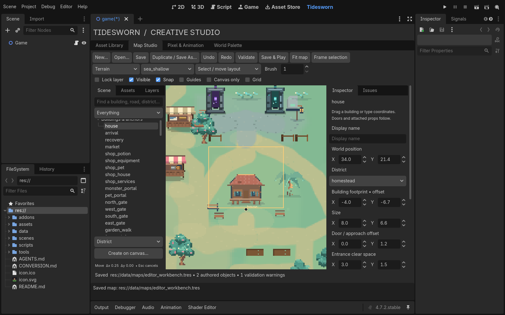

# Map Studio: shape your own village

Open `project.godot` in Godot 4.7.2, choose **Tidesworn** at the top, then
**Map Studio**. Start with **Duplicate / Save As…** to make a working map such as
`res://data/maps/my_village.tres`. Source maps and normal player progress are
separate. [Implementation and verification](MAP_STUDIO_UPGRADE.md).

## Find and move anything

The **Scene** sidebar lists buildings/anchors, roads, districts, scenery,
workpoints, authored objects and original trees/props. Search by name or stable
ID. The category filter also limits what clicks can select, making overlapping
roads and districts easier to reach. Double-click an entry to frame it.

The default **Select / move layout** tool also selects directly in the canvas.
Click the house or shop itself, rather than searching for its bottom pivot.
Drag to move it; a highlighted outline previews the change. Releasing commits
one undo action. **Esc** or right-click cancels it. Dragging preserves the grab
offset, so the feature does not jump to the cursor. Snap uses quarter units.

The **Inspector** shows world X/Y near the top. Change them and choose **Apply
changes** for an exact position. Existing buildings keep their gameplay identity;
their attached props, entrances, workpoints and connected road endpoints follow
the appropriate owning anchors. Use **Save & Play** to inspect the actual result.

Footprint, door offset, entrance clear space and maintained yard are editable.
Footprints/yards describe authoring reservations and spacing; changing them does
not resize a service's builder-owned physics collider. Check actual movement in
Play after large changes.

## Make a central commons and connecting lanes

1. Choose **Landmark / commons** under the Scene list, then **Create on canvas…**.
   Click your proposed centre. Give it a display name in the Inspector.
2. Choose **District**, create it near that point, and frame the selection with
   **F**. Drag its blue vertices to define the open green. Use **+ Point…**, then
   click an edge to add another vertex. **− Point** removes the selected vertex;
   a district retains at least three.
3. Pick its ground material, **Edge blend width**, and **Ground tint**. A wider
   blend and a restrained tint soften transitions into neighbouring areas. Start
   around 3–4 units of blending; inspect both the overview and the real game.
4. Choose **Road**, create it, then choose **From** and **To** anchors in the
   Inspector. Connect the commons to a residential gate, market, harbour or farm.
   Choose road width, surface, hierarchy and **Soft edge**, then Apply.
5. Add road bends with **+ Point…**, clicking where the bend should go. Drag amber
   handles to refine the route. Road endpoints follow their anchors; they are
   changed with From/To rather than detached by dragging.

A commons landmark is a named routing point. It does not create another shop,
quest, player spawn or NPC. You compose its appearance with district ground,
paths, existing buildings and accessories. Roads/districts support Duplicate
and Delete, with native undo. Deleting roads can disconnect destinations; inspect
the Issues tab as you work.

## Move a whole district

Select a district and enable **Move district contents**. Drag inside its polygon
away from a vertex handle. The transaction shifts the boundary, anchors assigned
to that district, associated accessories, authored props inside the boundary and
road bends inside it. Attached props and workpoints follow their anchors.

With the option off, dragging inside moves just the boundary. Dragging a vertex
always reshapes just the boundary. A zone's physical polygon and a building's
assigned District are distinct: use the building Inspector to assign membership.
This makes it possible to reorganize a district before redrawing its boundary.

Original forest trees are not carried by district moves. To move one deliberately,
select it under **Base trees & props**: the edit creates an independent source-map
override retaining its existing tree ID. Deleting that override returns it to its
base position. No editor action rewrites the fixed forest-generation sequence.

## Props, art and workpoints

**Assets** contains thumbnails for built-in props and registered artwork. Search,
select a thumbnail, then click the map to place it. Choose **Refresh imported art**
after registering or editing artwork elsewhere. Press **V** to return to selection.
Placed objects have their own IDs and editable labels, scale, depth, footprints,
collision/interaction flags and metadata. **Ctrl+D** duplicates with a new ID;
**Delete** removes the selection. Both can be undone.

An asset-palette house is an authored visual object, not another functional player
house. Move existing services through their anchor entries. Existing service and
actor identities cannot be deleted from the spatial editor.

**Scenery** is the curated workspace layer. Its Inspector edits the asset, owning
anchor, district, scale and ground footprint. The world position fields are
converted to the owning anchor's local offset. Attached scenery follows its
building. Runtime and preview hide accessories that cross reserved circulation.

Choose **Workpoints** to edit existing routines. Purple handles are actual authored
destinations. Select a handle, drag it, or edit its world X/Y and point anchor.
**+ Point…** appends another destination; **− Point** removes one while retaining
at least one point. Changing an owner/point anchor preserves the displayed world
position when Apply converts it back to a local offset. Actor roles and species
remain content-resource settings.

## Paint and manage layers

Use **Pencil**, **Eraser**, **Rectangle**, **Fill**, **Eyedropper**, **Select** and
**Move** from the tool selector for sparse tile overrides. Choose the layer,
material and brush size first. Select then Move shifts a tile region.

The **Layers** sidebar shows every paint layer with Show/Lock controls. Show affects
this editor view; it does not remove runtime content. Locks prevent painting on
that layer. Both are undoable and saved as editor settings. Water and Collision
layers create runtime collision. Land paint does not reclaim the sea.

**Guides** toggles the background spatial overlays. Selected handles remain visible
even with guides off. **Grid** toggles cell lines. **Canvas only** hides both
sidebars and fits the complete village into the available space; toggle it off
to return to the Inspector.

## Save, validate and play

**Validate** opens the Issues tab. Select an issue to locate its feature. Checks
cover disconnected/invalid road endpoints, bounds, polygon validity, building
spacing, blocked circulation and authored collision. Some conservative warnings
need an actual movement check in Play.

**Save & Play** saves the current document, then launches the actual game with that
map and isolated preview progress. Warnings remain available while you test an
unfinished design; they no longer prevent launching. A failed save does prevent
launching. The launcher currently uses Linux's `/usr/bin/env`.

Save As keeps the shipped map intact. Ordinary gameplay still loads
`res://data/maps/village.tres`; saving another filename does not change that default.
When ready to adopt your design, preserve a working copy, then explicitly save it
as `village.tres`. Player settlement positions still take precedence during normal
play. Existing player customizations can therefore differ from the source preview.

Undoing back to the saved state clears the unsaved indicator. Opening a different
document prevents older native undo actions from changing the new map. Unsaved
work is retained by the existing Studio recovery drafts on plugin reload. Source
art/maps are written only through Save, and terrain edits regenerate a preview
without automatically overwriting the source terrain bake.

## Canvas shortcuts

These operate while the canvas has keyboard focus; typing in an Inspector field
keeps ordinary text editing behavior.

| Key / gesture | Action |
|---|---|
| Wheel | Zoom around the cursor |
| Middle drag / Space + left drag | Pan |
| V | Select / move layout |
| F / double-click Scene item | Frame selection |
| Home | Fit map |
| Tab | Toggle canvas-only mode |
| Arrows / Shift + arrows | Nudge 0.25 / 1 world unit |
| Ctrl+S | Save |
| Ctrl+Z / Ctrl+Shift+Z / Ctrl+Y | Undo / redo |
| Ctrl+D | Duplicate supported feature |
| Delete / Backspace | Delete supported feature |
| Esc / right-click | Cancel current gesture |

The map envelope remains 64 × 40 units. Dynamic lighting, live actors, animations,
ruin damage and player customization are checked in Save & Play rather than
simulated by the static authoring canvas.
