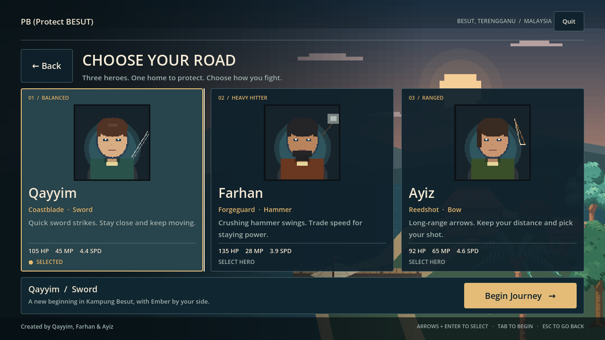

# PB title and journey flow

Boot menu implemented and verified on 2026-10-24 with Godot 4.7.2 on Linux.
The horizontal page track and current Adam-only, lock-aware flow were verified
on 2026-10-28.

The boot screen now gives the village its own introduction: a dusk harbour,
warm cottage lights, a sailing boat, large cream typography and gold journey
actions. The backdrop reuses cached village art, with layered sky, coastline
and restrained water/boat motion. It owns no gameplay nodes, placement RNG or
world clock. Low effects quality and Reduce Motion preserve the complete static
scene and stop its animation immediately.

## Page transition

Start Game does not cross-fade. Both pages share one clipped horizontal track
inside the page body: the menu leaves to the left and **CHOOSE YOUR ROAD**
arrives from the right over 0.36 s (cubic ease in/out). Back and Escape play the
reverse. A reversal mid-slide continues from the stored progress with a
proportionally shorter duration instead of restarting, and a window resize
re-derives travel from that progress so the pages never separate.

The transition is presentation only: `current_page`, page visibility, footer
hint and the save-guard state change on the click frame, so handoff and input
guards never wait for animation. Both pages are text-inert while travelling;
the destination page restores pointer and keyboard focus on arrival (an open
overlay keeps its own focus). Reduce Motion swaps pages instantly with no
travel and no fade.

## Journey flow

| Screen | Action | Result |
| --- | --- | --- |
| Boot menu | Start Game | Slide the Choose Your Road page in from the right; keep any save intact |
| Choose Your Road | Click/touch a hero card | Preview that hero and weapon |
| Choose Your Road | Back / Escape | Return to menu; remember the pending choice |
| Choose Your Road, no save | Begin Journey | Start Adam's story in Besut Village |
| Choose Your Road, existing save | Begin Journey | Show saved journey and replacement warning |
| Replacement warning | Keep Saved Journey / Escape | Cancel without changing save bytes |
| Replacement warning | Replace Save & Begin | Start exactly one new journey |
| Boot menu, existing save | Continue Journey | Resume the saved village or expedition directly |
| Boot menu, missing/unreadable save | Continue Journey | Keep the menu usable and show an inline error |

Hero cards show their existing portraits, names, weapon disciplines and starter
HP/speed from CharacterDB. A separate Begin Journey action makes selection
deliberate. Existing combat, movement, economy, forest associations, tutorials
and save format are unchanged. The existing loading cover still owns world
transitions.

How to Play, Settings and Credits are accessible before a save exists. Title
settings write only GameSettings: master volume, mute, Reduce Motion and effects
quality. More camera/interface settings remain in the world HUD menu. Every
button supports focus and keyboard activation; overlays restrict page focus,
restore it on close and support Escape. Replacement defaults focus to the safe
Keep Saved Journey action. Begin/Continue reject duplicate handoffs.

The compact landscape menu places the introduction beside the actions. Compact
hero cards retain portraits, names, weapons, vitals and lock state; the longer
tactical copy and the rescue paragraph are omitted (tapping a locked card still
shows its full rescue route). Narrow layouts stack cards in a scrolling region
with a persistent Begin Journey strip and Back action. A page fit pass keeps the
stage-sized confirmation strip visible at every window size.

## Verification

- 2026-10-28: `./tools/test_isolated.sh`: **1,326 checks, PASS**, exit 0; no
  `[FAIL]`, `SCRIPT ERROR` or `ERROR:` output. The gate includes the title
  state/save regressions and six new page-track checks (travel starts, settles
  flush, never fades, Back returns flush, Reduce Motion swaps and restores
  instantly).
- 2026-10-28: `./tools/review_title.sh /absolute/output`: **54 checks, 0
  failures**, exit 0, including a mid-slide capture. It drives the intro story's
  real Skip action before expecting the village.
- 2026-10-28: `res://tools/opening_fishing_test.tscn` at 832x480: **138 checks,
  PASS**, exit 0; the handoff fixture waits for the page track before tapping
  Begin.
- Earlier dated run: 920 checks and 50 title-review checks on the pre-lock,
  pre-story flow. That log is historical; current counts above supersede it.
- Inspected full-resolution captures at 1280x720, 832x480 and 600x900. Complete
  cards fit both landscape fixtures; narrow cards stack with journey actions
  retained. The mid-slide frame shows both pages tiled inside the clip with no
  seam or gutter bleed.
- Final editor import and `git diff --check` pass. Every harness uses verified
  temporary user data. Live progress is never restored from a test fixture.

The native run uses Mesa llvmpipe under Xvfb. Its X input-method and unsupported
VSync warnings are host limitations; there are no script/error markers or
message-queue failures. These fixtures verify desktop rendering and synthetic
touch delivery, not physical Android/Windows devices or hardware performance.

Earlier evidence (pre-page-track):
[native log](evidence/title-screen/native-review.log),
[acceptance log](evidence/title-screen/acceptance.log),
[compact menu](evidence/title-screen/compact-menu.png),
[compact heroes](evidence/title-screen/compact-heroes.png),
[narrow heroes](evidence/title-screen/narrow-heroes.png),
[settings](evidence/title-screen/settings.png),
[replacement](evidence/title-screen/replace-save.png),
[failed Continue](evidence/title-screen/continue-error.png).
The 2026-10-28 runs write their captures to the external output directory
printed by `review_title.sh`; they are not committed to the repository.

Runtime ownership: `scripts/ui/title_screen.gd` builds the menu, page state and
title overlays; `scripts/ui/title_backdrop.gd` draws its harbour; Game receives
the existing handoff signals. GameState now checks the result of `load_game()`
before continuing and parses damaged JSON without emitting a script error.
It leaves unreadable files untouched.
